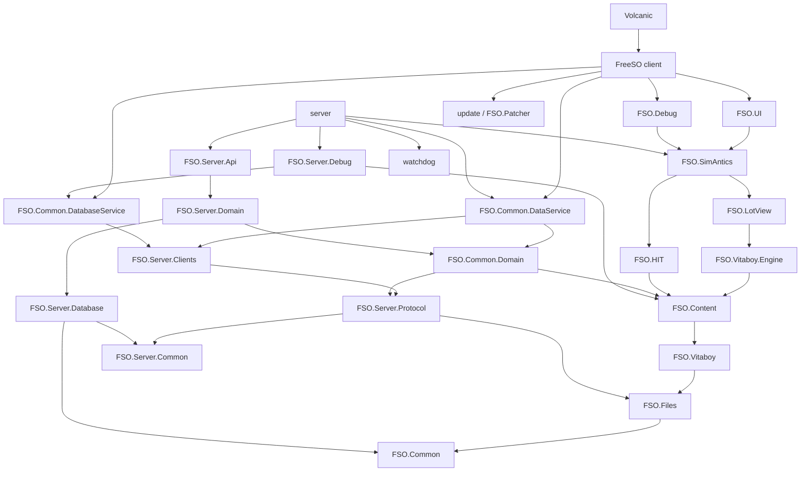

# Architecture overview

This page shows how the 2017 FreeSO snapshot fits together: the layers,
the project dependencies, and what happens at run time. Each layer has
its own page; links are in the [index](./README.md).

## The big picture

FreeSO is a client and a set of servers for The Sims Online, written
from scratch in C#, that read the original game's installed files at run
time. Nothing from the original game is in the repository.

```text
                      +-------------------------------+
                      |  Original TSO install (EA)    |
                      |  FAR archives, IFFs, audio,   |
                      |  UI scripts, datadefinition   |
                      +---------------+---------------+
                                      | read at run time
          +---------------------------+---------------------------+
          |                                                       |
+---------v----------+    HTTP (login, city select)    +----------v---------+
|  FreeSO client     |<------------------------------->|  server.exe         |
|  MonoGame, UI,     |    Aries/Voltron/Electron TCP   |  API, city, lot,    |
|  SimAntics (copy)  |<------------------------------->|  task services;     |
+--------------------+    lockstep VM ticks            |  SimAntics (master) |
                                                       +----------+----------+
                                                                  |
                                                       +----------v----------+
                                                       |  MySQL               |
                                                       +---------------------+
```

The key design choice is **deterministic lockstep simulation**: every
client and the lot server run the same SimAntics VM on the same inputs,
and the server only orders and broadcasts commands. See
[simantics.md](./simantics.md#multiplayer-deterministic-lockstep).

## Layers

From the bottom up:

| Layer | Projects | Page |
| --- | --- | --- |
| Shared foundations | FSO.Common | [common.md](./common.md) |
| File formats | FSO.Files | [files.md](./files.md) |
| Avatar model | FSO.Vitaboy | [rendering.md](./rendering.md#vitaboy-avatars) |
| Content | FSO.Content | [content.md](./content.md) |
| Rendering | FSO.Vitaboy.Engine, FSO.LotView | [rendering.md](./rendering.md) |
| Audio | FSO.HIT | [audio.md](./audio.md) |
| Simulation | FSO.SimAntics | [simantics.md](./simantics.md) |
| Protocol and data | FSO.Server.Protocol, FSO.Server.Clients, FSO.Common.DataService, FSO.Common.DatabaseService, FSO.Common.Domain | [protocol.md](./protocol.md) |
| UI framework | FSO.UI | [client.md](./client.md#ui-framework-fsoui) |
| Client | FreeSO (`tso.client`), FSO.Debug, FSO.Patcher | [client.md](./client.md) |
| Server | server (`FSO.Server`), FSO.Server.Database, FSO.Server.Common, FSO.Server.Domain, FSO.Server.Api, watchdog | [server.md](./server.md) |
| Tools | Volcanic (`FSO.IDE`), FSO.Server.Debug, FSOInstaller, Charvatia, `Other/` | [tools.md](./tools.md) |

## Project dependencies

Direct project references in `FreeSO.sln`, with edges implied by other
edges removed (so `A --> B` means A uses B, and everything B uses).
MonoGame, Mina.NET, and third-party libraries are left out.



Things the graph shows:

- **MonoGame reaches almost everything.** FSO.Common references
  MonoGame, so every project that uses FSO.Common does, including the
  server and the database layer. Only FSO.Server.Common, the patcher,
  and the watchdog are free of it.
- **The server needs a renderer.** `server` references FSO.SimAntics,
  which references FSO.LotView. It also references FSO.Server.Debug, a
  WinForms project, so the server can't drop Windows Forms without code
  changes.
- **Shared code depends on content.** FSO.Common.Domain (lot pricing,
  shards, top 100) references FSO.Content, which pulls in the whole
  content and graphics stack.
- **The UI framework depends on the simulation.** FSO.UI references
  FSO.SimAntics, so the UI library can't be reused without the VM.

The [modernization guide](./modernization.md) uses these points to plan
the new project split.

## Runtime flows

### Client start to lot

1. `Program.Main` resolves the game install and the MonoGame binary,
   then starts `TSOGame` ([client.md](./client.md#startup)).
2. `TSOGame.Initialize` scans the install and builds all content
   providers ([content.md](./content.md#the-content-singleton)).
3. The login screen drives `LoginRegulator` over HTTP, then
   `CityConnectionRegulator` opens the city Aries connection with a shard
   ticket ([protocol.md](./protocol.md#logging-in)).
4. The city view renders the map ([rendering.md](./rendering.md#city-view))
   and fills it from the data service.
5. Joining a lot: `LotConnectionRegulator` asks the city for a lot
   server, connects, and receives a full VM state, then a stream of tick
   batches ([simantics.md](./simantics.md#multiplayer-deterministic-lockstep)).
6. Each frame: the VM runs the ticks that are due, LotView redraws what
   changed, HIT ticks sounds, and the UI updates.

### Server

1. `server run` reads `config.json`, initializes content in server mode,
   and starts each enabled service ([server.md](./server.md#startup)).
2. Lot servers connect to their cities over Gluon and advertise
   capacity.
3. When a player joins a lot, the city picks a lot server, which loads
   the lot's save, starts a VM thread, and accepts the player.
4. Lot servers save lots and avatars periodically; the task server runs
   nightly jobs.

## Cross-cutting patterns

| Pattern | Where | Notes |
| --- | --- | --- |
| Static singletons and facades | `Content.Get()`, `HITVM.Get()`, `GameFacade`, `FSOFacade`, `GlobalSettings.Default`, `FSOEnvironment` | Global state everywhere; the main obstacle to testing. |
| Ninject DI | client modules, server modules, child kernels per city | Only partly used; much code still reaches for statics. |
| Reflection | IFF chunk registry, packet registries, UIScript binding, data service serializers, Aries packet router | Simple to extend, but slow to start and incompatible with trimming. |
| Game thread marshaling | `GameThread.NextUpdate`, regulators' background threads | Manual; there is no `SynchronizationContext`. |
| Timed weak-reference caches | `TimedReferenceController`, `IffFile` finalizer | Memory is released by the garbage collector on its own schedule. |
| Lockstep simulation | SimAntics net drivers | Requires determinism everywhere in VM code. |
| Case-insensitive file system assumptions | content regexes, project folders with two casings, `\` in paths | Works on Windows, breaks on Linux and macOS. |

## Frameworks and platforms

- 27 projects target .NET Framework 4.5 (one targets 4.5.2).
- `TSOClient.csproj` targets .NET 3.5 with XNA and is not in the solution.
- `FSODroid` and `FSO.iOS` are Xamarin projects, not in the solution.
- Linux and macOS were supported through **Mono**: `MonogameLinker`
  picks a MonoGame build per OS, and `LinuxLocator`/`MacOSLocator` find
  the game. Windows-only pieces (WinForms tools, `System.Speech`, the
  registry) are skipped or guarded at run time rather than at build time.
